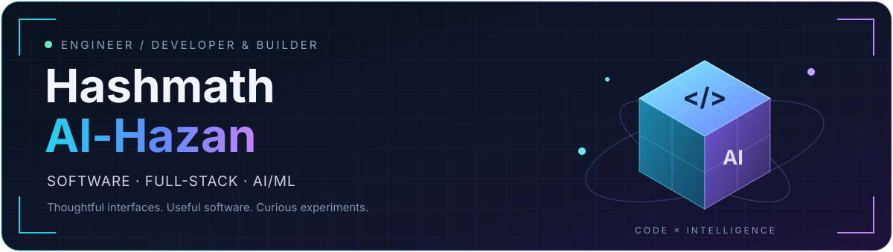
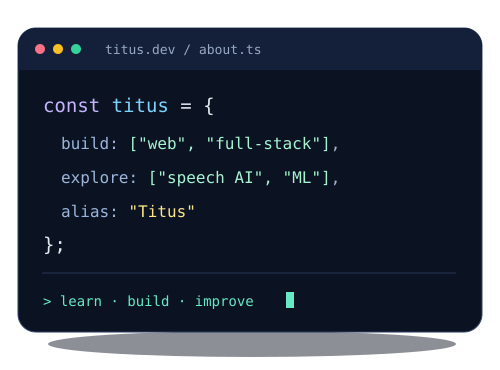
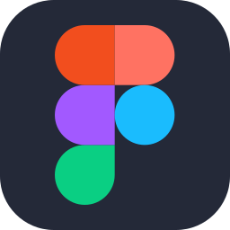
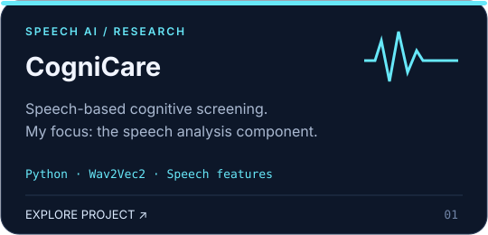
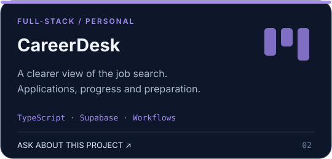
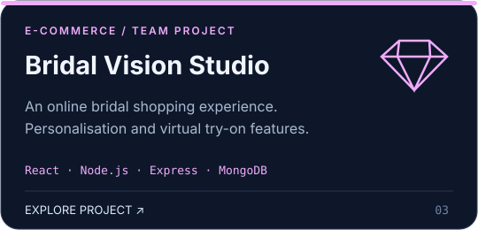
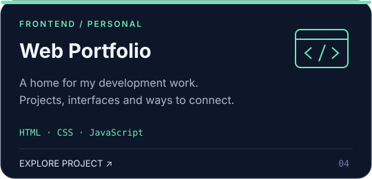
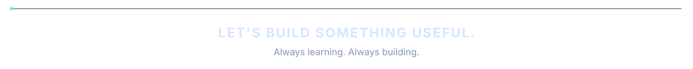

<!-- Upload README.md AND the assets folder to your profile repository. -->

  

  <b>Software Developer · Full-Stack Development · Applied AI</b> 
  Sri Lanka 🇱🇰 &nbsp; / &nbsp; You can call me Titus.

  

  
  
  
  

---

<h2 align="center">A little about me</h2>

<table>
  <tr>
    <td width="52%" valign="middle">
      
👋 <b>Hi, I'm Hashmath — call me Titus.</b>

      
🎓 Software Engineering graduate from <b>SLIIT</b>.

      
💻 I build with <b>React, Next.js and TypeScript</b>.

      
🧠 Exploring <b>applied AI, machine learning and speech processing</b>.

      
🔬 Speech analysis contributor to <b>CogniCare</b>, with research presented at <b>IEEE TENSYMP 2026</b>.

      
💬 Ask me about <b>frontend development, MERN and API integration</b>.

      
📫 <a href="mailto:hashmathalhazan@gmail.com">hashmathalhazan@gmail.com</a>

    </td>
    <td width="48%" align="center" valign="middle">
      
    </td>
  </tr>
</table>

<h2 align="center">My creative toolkit</h2>

<b>Frontend &amp; interfaces</b>

  
  
  
  
  
  
  
  

<b>Backend &amp; data</b>

  
  
  
  

<b>AI / ML research</b>

  

  <code>Wav2Vec2</code> &nbsp; <code>Speech-to-text</code> &nbsp; <code>Acoustic features</code> &nbsp; <code>Transcript analysis</code>

<b>Tools &amp; collaboration</b>

  
  
  
  
  

---

<h2 align="center">Things I've been building</h2>

A mix of web development, practical tools and applied AI research.

<table>
  <tr>
    <td width="50%" valign="top" align="center">
      
      
<a href="https://github.com/HashmathAl-Hazan/CogniCare-AI-Powered-Cognitive-Screening-Dementia-Risk-Analysis-Platform"><b>Explore my contribution ↗</b></a>

    </td>
    <td width="50%" valign="top" align="center">
      
      
<a href="mailto:hashmathalhazan@gmail.com?subject=CareerDesk%20project"><b>Ask about CareerDesk ↗</b></a>

    </td>
  </tr>
  <tr>
    <td width="50%" valign="top" align="center">
      
      
<a href="https://github.com/HashmathAl-Hazan/Bridal-Vision-Studio"><b>Explore Bridal Vision Studio ↗</b></a>

    </td>
    <td width="50%" valign="top" align="center">
      
      
<a href="https://hashmathtitus.netlify.app/"><b>Visit my website ↗</b></a>

    </td>
  </tr>
</table>

<h2 align="center">My GitHub activity</h2>

<!-- These three cards load public GitHub data from a third-party service. -->

  
  

  

  

  
Design credits

  
Technology icons: <a href="https://github.com/tandpfun/skill-icons">Skill Icons</a> (MIT; licence included in assets/icons). GitHub cards: <a href="https://github.com/vn7n24fzkq/github-profile-summary-cards">GitHub Profile Summary Cards</a>. Decorative motion is implemented with SVG; the cube is a 3D-style illustration.

